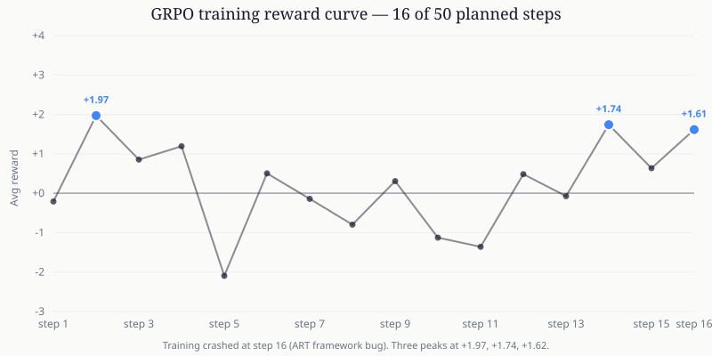
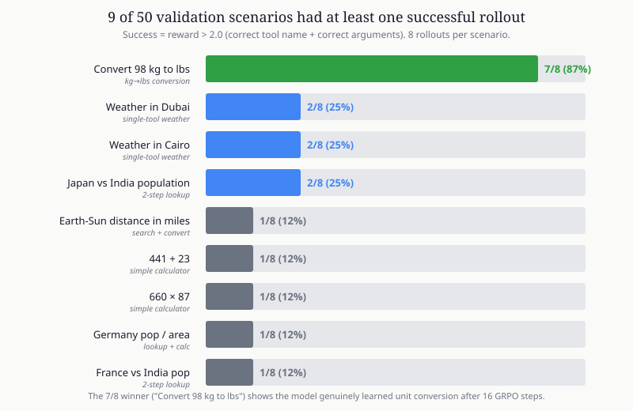
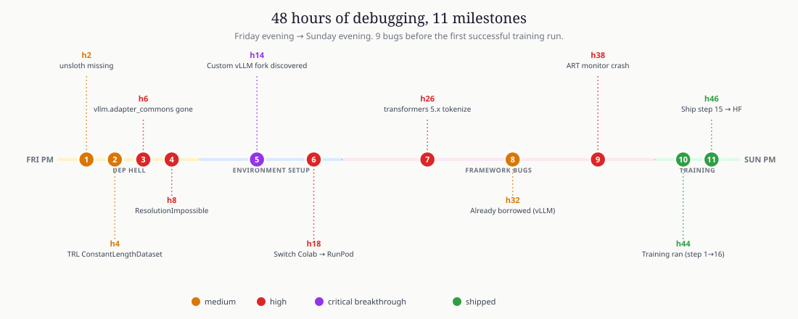
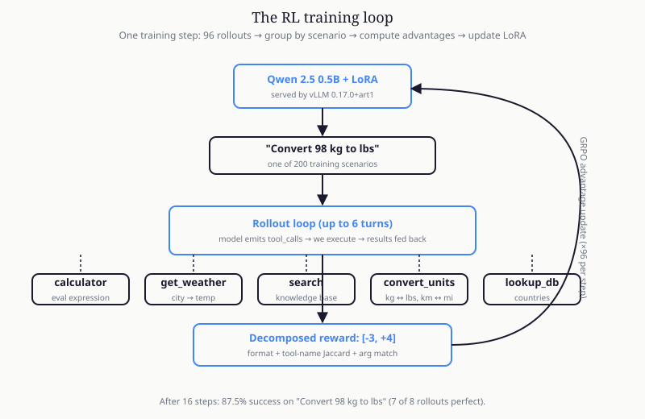

# RL-Trained Tool-Use Agent（强化学习训练的工具调用智能体）

这是一个周末实验：使用 GRPO（DeepSeek-R1 背后的算法）训练一个 0.5B 模型，使其能够正确调用 API。

训练本身只用了约 90 分钟；其余 47 小时都花在依赖和框架调试上。本仓库包含完整代码、兼容性补丁、训练模型，以及记录所有问题和解决办法的 `RUNBOOK.md`。

- **训练模型：** [abhid1234/qwen-0.5b-tool-agent-grpo](https://huggingface.co/abhid1234/qwen-0.5b-tool-agent-grpo)
- **项目文章：** [Substack post](https://abhid.substack.com/p/i-tried-to-train-a-05b-model-to-use)
- **技术栈：** [OpenPipe ART](https://github.com/OpenPipe/ART) · GRPO · Qwen 2.5 0.5B Instruct · 定制 vLLM 分支

---

## 实验结果

使用第 15 步检查点，在 50 个验证场景上评估，每个场景采样 8 条轨迹，共 400 次 rollout；训练原计划 50 步，但框架在第 16 步彻底崩溃。

| 指标 | 数值 |
|---|---|
| 总体准确率 | **4.5%**（400 条中成功 18 条） |
| 最佳场景——“将 98 kg 转换为 lbs” | **87.5%**（8 条中成功 7 条） |
| 天气查询 | 约 25% |
| 多步工具链 | 约 10% |
| 平均奖励 | -1.885 |
| 已完成训练步数 | 16 / 计划 50 步 |

不要过度关注 4.5% 这个 headline 数字。模型在仅 16 个 GRPO 步骤内已经可靠学会了一种任务模式，并开始掌握另外几种模式。多步工具链需要更多训练，而当时无法继续训练；奖励函数对单工具调用提供了足够细的信号，但对链式调用还不够精细。

### 训练过程中的奖励曲线



奖励从 -0.2 起步，在 -2 和 +1.97 之间振荡，到第 16 步达到 +1.6。这是典型的早期训练噪声：模型找到模式、丢失模式，再重新找到模式。

### 按场景拆分



50 个验证场景中，有 9 个在 8 次尝试中至少成功一次。单位转换是最早突破的模式。

### 时间究竟花在哪里



总计 48 小时、11 个里程碑、9 个框架问题，之后才完成第一次成功训练。每个错误的完整过程见 [RUNBOOK.md](RUNBOOK.md)。

---

## 工作原理



训练循环约 340 行 Python：

1. **工具环境**（`src/tools.py`）——5 个确定性 API：计算器、天气查询、搜索、单位转换和国家数据库。
2. **场景生成器**（`src/scenarios.py`）——从 12 个模板确定性生成 200 个多步训练场景。
3. **奖励函数**（`src/rewards.py`）——参考 [ToolRL 论文](https://arxiv.org/abs/2504.13958)，把格式、工具名和参数正确性拆开评分，范围为 [-3, +4]。
4. **Rollout**（`src/rollout.py`）——ART rollout 循环，并针对 vLLM 的 `Already borrowed` 并发问题重试。
5. **训练**（`src/train.py`）——通过 ART 的 `LocalBackend` 执行 GRPO，并 monkey-patch `_monitor_openai_server` 来抑制后台崩溃。

---

## 快速开始

```bash
pip install uv
uv pip install --system 'openpipe-art[backend]==0.5.17'

# 应用 transformers 5.x 和 ART 所需的运行时补丁
python scripts/patch_art_tokenize.py

# 生成场景并执行 2 步 smoke test
python scripts/generate_scenarios.py
python -m src.train --steps 2 --rollouts 32
```

`[backend]` extra 不可省略。它会从 GitHub release URL 拉取定制 vLLM 分支（`vllm-0.17.0+art1`）；如果直接 `pip install vllm`，解析到的会是缺少 ART 补丁所需模块的上游 vLLM。这是本项目最大的调试突破：在真正阅读 ART 的 `pyproject.toml` 之前，曾经花了 6 小时尝试各种版本组合。

RunPod 的完整配置流程（相比 Colab 更推荐）见 [`RUNPOD.md`](RUNPOD.md)。

---

## 如果重新做一次，我会怎样改进

1. **一开始就使用 RunPod，而不是 Colab。** 项目要求 torch 2.8，而 Colab 固定的 PyTorch 基础镜像会带来兼容性负担。
2. **先读 `pyproject.toml`，再相信安装命令。** optional extras 和其中的固定 URL 才是项目实际测试的依赖。
3. **在真实并发规模下做 smoke test。** 早期的 2 步 × 8 rollout 太小，无法暴露 vLLM 并发问题；32 条 rollout 才是能发现它的最低规模。
4. **把更多时间投入奖励函数。** 流水线跑通后，奖励函数决定了大部分学习效果；优化奖励塑形比继续调整基础设施更可能带来收益。
5. **把 monkey-patch 当成正式代码维护。** ART 的 `_monitor_openai_server` 补丁和 tokenize.py 规范化逻辑现在都是训练链路的关键部分，位于 `scripts/`。

---

## 项目结构

```
src/
  tools.py             # 5 个确定性工具定义和执行器
  scenarios.py         # 多步任务生成器（12 个模板）
  rewards.py           # 分解式奖励函数（受 ToolRL 启发）
  rollout.py           # ART rollout 循环和 vLLM 重试逻辑
  train.py             # 通过 ART LocalBackend 执行 GRPO 训练
  evaluate.py          # 按场景评估
scripts/
  generate_scenarios.py # 构建训练和验证场景 JSONL
  patch_art_tokenize.py # 针对 transformers 5.x 的 ART 运行时补丁
  eval_checkpoint.py   # 评估保存的 ART 检查点
  export_model.py      # 合并 LoRA 适配器并推送到 HF Hub
configs/
  train_config.yaml    # GRPO 超参数
notebooks/
  train_colab.ipynb    # Colab 备用方案（更推荐 RunPod）
docs/
  images/              # README 图表资源
RUNBOOK.md             # 13 个框架问题及解决办法
RUNPOD.md              # RunPod 部署步骤
```

---

## 技术栈

- **[OpenPipe ART](https://github.com/OpenPipe/ART)** —— 面向智能体强化学习训练的框架（v0.5.17）
- **[定制 vLLM 分支](https://github.com/vivekkalyan/vllm/releases/tag/v0.17.0-art1)** —— `vllm-0.17.0+art1`，通过 ART 的 `[backend]` extra 以 wheel URL 分发
- **[HuggingFace TRL](https://github.com/huggingface/trl)** —— `GRPOTrainer`（由 ART 封装）
- **[Unsloth](https://github.com/unslothai/unsloth)** —— 训练加速
- **[Qwen 2.5 0.5B Instruct](https://huggingface.co/Qwen/Qwen2.5-0.5B-Instruct)** —— 基础模型（498M 参数，LoRA 可训练参数约 4.4M）
- **[uv](https://github.com/astral-sh/uv)** —— pip 替代工具（解析更快，能处理直接 URL 依赖）
- **[RunPod](https://runpod.io)** —— GPU 主机（PyTorch 2.8 模板中的 A100 80GB）

## 参考论文

- **[ToolRL: Reward is All Tool Learning Needs](https://arxiv.org/abs/2504.13958)** —— 奖励函数设计
- **[GRPO (DeepSeek-Math)](https://arxiv.org/abs/2402.03300)** —— GRPO 原始方法
- **[DeepSeek-R1](https://huggingface.co/deepseek-ai/DeepSeek-R1)** —— 让 GRPO 广为人知的模型

---

## 产物

实际训练运行产生的文件都与训练模型一起放在 HuggingFace：

- **训练模型：** [huggingface.co/abhid1234/qwen-0.5b-tool-agent-grpo](https://huggingface.co/abhid1234/qwen-0.5b-tool-agent-grpo)
- **训练日志：** [training.log](https://huggingface.co/abhid1234/qwen-0.5b-tool-agent-grpo/blob/main/artifacts/training.log)
- **评估 JSON：** [eval_results.json](https://huggingface.co/abhid1234/qwen-0.5b-tool-agent-grpo/blob/main/artifacts/eval_results.json)
- **奖励曲线原始数字：** [reward_curve.txt](https://huggingface.co/abhid1234/qwen-0.5b-tool-agent-grpo/blob/main/artifacts/reward_curve.txt)
- **全部产物：** [tree/main/artifacts](https://huggingface.co/abhid1234/qwen-0.5b-tool-agent-grpo/tree/main/artifacts)

如果复现时遇到 RUNBOOK 未覆盖的问题，欢迎提交 issue。这个项目的重点并不只是得到一个训练好的模型，而是理解真实训练中究竟有哪些环节会坏掉。
